# MouManTAI

<p align="center">
  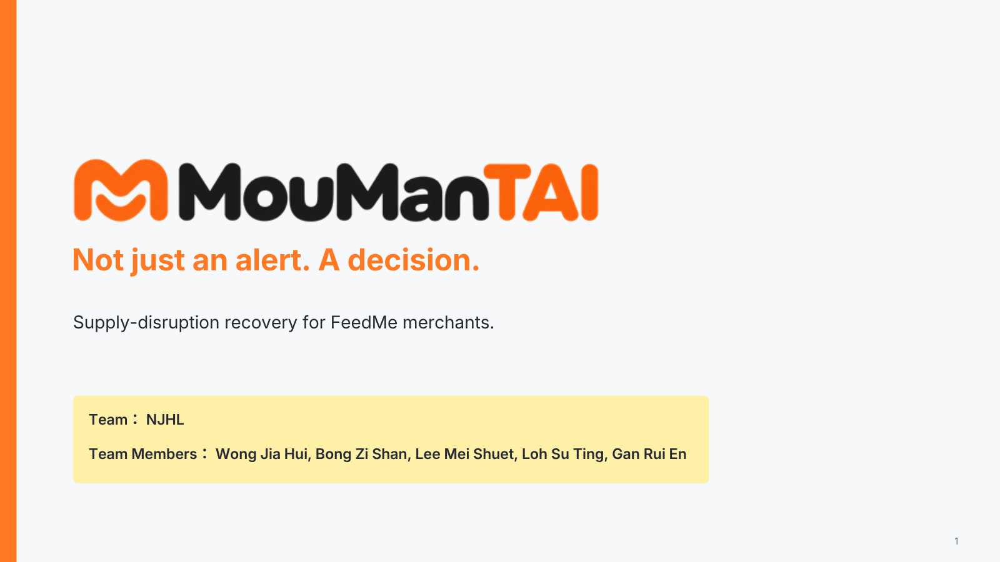
</p>

<p align="center">
  <b>Supply-disruption recovery for FeedMe merchants: turn a supplier message into an assessed impact, two costed recovery plans, a manager-approved decision and a verified outcome.</b>
</p>

<p align="center">
  
  
  
  
  
  
</p>

<p align="center">
  <a href="https://frontend-blue-pi-70ejij1ipo.vercel.app">🌐 Live Demo</a> ·
  <a href="https://htmlpreview.github.io/?https://github.com/jiahui-1101/MouManTAI_SUC/blob/main/presentation/moumantai-presentation.html">🖥️ HTML Presentation</a> ·
  <a href="presentation/moumantai-presentation.pdf">📄 PDF Slides</a> ·
  <a href="presentation/assets/interview.mp4">🎥 Merchant Interview</a>
</p>

---

## Table of Contents

- [Track & Problem Statement](#track--problem-statement)
- [Introduction](#introduction)
- [Live Deployment](#live-deployment)
- [Customer Validation](#customer-validation)
- [System Flow](#system-flow)
- [System Architecture](#system-architecture)
- [Worked Example: The Chicken Delivery](#worked-example-the-chicken-delivery)
- [Core Features](#core-features)
- [Plan A vs Plan B](#plan-a-vs-plan-b)
- [Decision Logic](#decision-logic)
- [Technical Stack](#technical-stack)
- [Installation](#installation)
- [Environment Variables](#environment-variables)
- [Cloud Deployment](#cloud-deployment)
- [Routes](#routes)
- [Project Structure](#project-structure)
- [Business Model](#business-model)
- [Project Materials](#project-materials)
- [Future Improvements](#future-improvements)
- [Team Contributions](#team-contributions)
- [Notes for Judges](#notes-for-judges)

---

## Track & Problem Statement

**Case:** Supply-disruption recovery for FeedMe restaurant merchants  
**Project Name:** MouManTAI  
**Team:** NJHL  
**Solution Type:** Intelligence add-on for the FeedMe Portal, with a web prototype on synthetic data

It's 10:00. Lunch is coming. A supplier messages: **today's chicken delivery is cancelled.** What do you do?

Restaurants already see low inventory. What they lack is the next step. Four Kuala Lumpur cafés were reported in Malay Mail (June 2026) facing the same problem:

| Café | What happened |
|---|---|
| Ground FLAW | Paused miso soup when the paste ran out |
| KLCG | Changed its pasta when suppliers couldn't deliver |
| Provisions | Substitute butter could change the taste of its bakes |
| Ordinary | Uncertainty over imported beef could force a menu pause |

Every time, the operator has to **find alternatives, change production, or disappoint customers**, usually by phone, under time pressure, without numbers.

MouManTAI turns that scramble into a decision:

- Read supplier messages from WhatsApp, Outlook and Telegram, and extract the PO, ingredient, quantity and status.
- Predict the real gap against today's demand, not just the cancelled quantity.
- Build two recovery options: **Plan A** (buy from a backup supplier) and **Plan B** (recover internally from stock, menu and prep).
- Let the manager compare, approve, execute and record the outcome, then feed what happened back into the forecasts.

---

## Introduction

MouManTAI is designed as a native extension inside the FeedMe Portal, which already knows each outlet's sales, stock and orders. It follows four steps:

```text
Supplier message (WhatsApp / Outlook / Telegram)
-> 1 Understand   extract PO, ingredient, quantity, status; staff confirm in one tap
-> 2 Predict      demand forecast x recipe BOM = ingredient need; gap vs stock
-> 3 Plan         hard rules first, then optimise Plan A and Plan B
-> 4 Decide       manager approves, execution tracked, outcome recorded
-> loop back      outcomes improve future forecasts
```

The prototype runs the full loop in the browser for a demo outlet, **Happy Potato**, on synthetic data with deterministic calculations.

---

## Live Deployment

| Resource | Link | Notes |
|---|---|---|
| Web App | [frontend-blue-pi-70ejij1ipo.vercel.app](https://frontend-blue-pi-70ejij1ipo.vercel.app) | Static Vite build on Vercel. Open **Overview → Supplier disruption demo** to start the scenario. |
| HTML Presentation | [moumantai-presentation.html](https://htmlpreview.github.io/?https://github.com/jiahui-1101/MouManTAI_SUC/blob/main/presentation/moumantai-presentation.html) | 16 slides. ← → to navigate, Space to autoplay, F for fullscreen. |
| PDF Slides | [moumantai-presentation.pdf](presentation/moumantai-presentation.pdf) | Same 16 slides as a 16:9 PDF; QR codes are clickable links. |
| Backend API | Not deployed | The Live Message Bridge is designed but not built. See [backend/README.md](backend/README.md). |

<p align="center">
  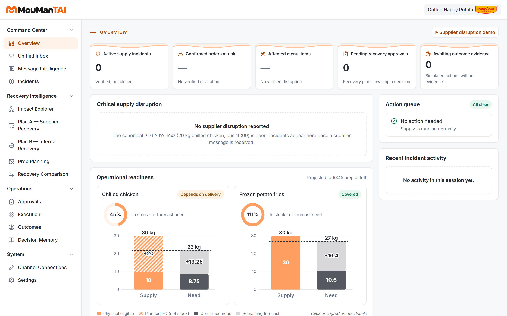
</p>

---

## Customer Validation

<p align="center">
  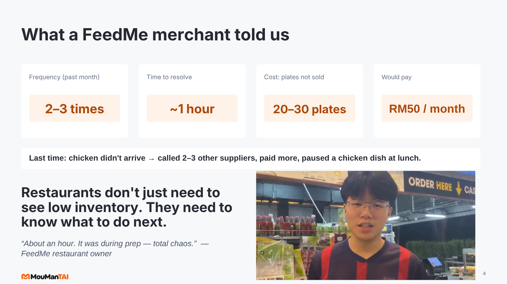
</p>

We interviewed a FeedMe restaurant owner ([full interview video](presentation/assets/interview.mp4)):

| Question | Answer |
|---|---|
| How often did supply break in the past month? | **2–3 times** |
| How long to resolve? | **About 1 hour.** "It was during prep — total chaos." |
| What did it cost? | **20–30 plates** not sold |
| What happened last time? | Chicken didn't arrive → called 2–3 other suppliers, paid more → paused a chicken dish at lunch |
| Would you pay for a fix? | **Yes, RM50 / month** |

> Restaurants don't just need to see low inventory. They need to know what to do next.

---

## System Flow

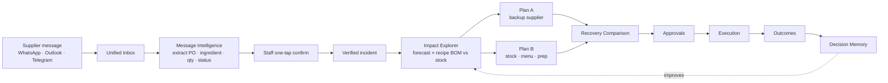

The same flow as a UML sequence, from the supplier's message to a verified outcome:

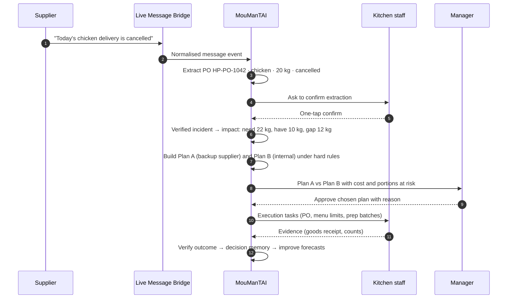

## System Architecture

<p align="center">
  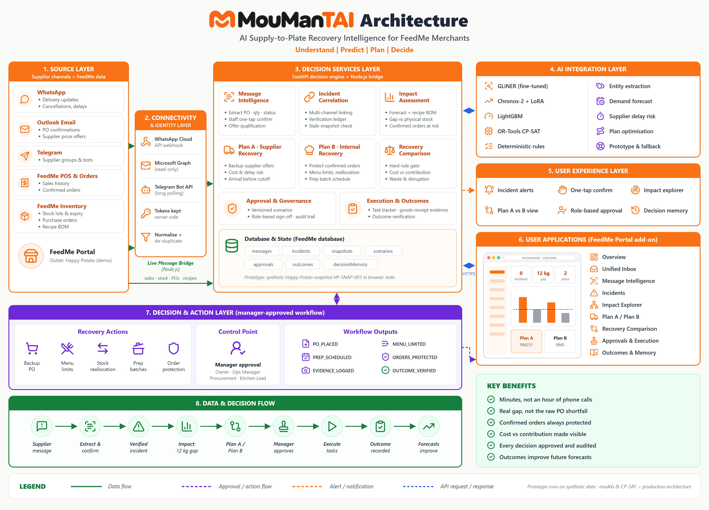
</p>

The diagram's editable source is [docs/images/system-architecture.svg](docs/images/system-architecture.svg).

| # | Layer | What it does |
|---|---|---|
| 1 | **Source** | Supplier messages from WhatsApp, Outlook and Telegram, plus FeedMe sales, orders, stock, POs and recipes |
| 2 | **Connectivity & Identity** | Live Message Bridge (Node.js): verified webhooks, read-only mailbox, bot polling, server-side tokens, normalised and de-duplicated events |
| 3 | **Decision Services** | Message intelligence, incident correlation, impact, Plan A, Plan B, comparison, approval, execution and outcomes, on the FeedMe database |
| 4 | **AI Integration** | GLiNER, Chronos-2 + LoRA, LightGBM, OR-Tools CP-SAT, with deterministic rules as fallback |
| 5 | **User Experience** | Alerts, one-tap confirm, impact explorer, Plan A vs B, role-based approval, decision memory |
| 6 | **User Applications** | The FeedMe Portal add-on pages, from Overview to Outcomes |
| 7 | **Decision & Action** | Manager-approved recovery actions: backup PO, menu limits, reallocation, prep batches, order protection |
| 8 | **Data & Decision Flow** | Message → confirm → incident → impact → plans → approval → execution → outcome → better forecasts |

MouManTAI is built in four layers. The table separates the **production architecture** from what the **prototype** in this repository does today.

| Layer | Production architecture | Prototype in this repo |
|---|---|---|
| **1 Understand** | Node.js Live Message Bridge (WhatsApp Cloud API, Microsoft Graph for Outlook, Telegram Bot API); fine-tuned **GLiNER** entity extraction; staff one-tap confirm | Synthetic multi-channel inbox, rule-based extraction, review and confirm flow |
| **2 Predict** | **Chronos-2 + LoRA** demand forecasting; recipe BOM to ingredient need; **LightGBM** supplier delay risk | Fixture forecasts, recipe BOM maths, impact assessment and stale-snapshot detection |
| **3 Plan** | **FastAPI** decision engine with **OR-Tools CP-SAT** | Deterministic Plan A / Plan B engines with hard-rule gating |
| **4 Decide & verify** | Approval, execution, outcome recording, decision memory | Versioned approvals, simulated execution, outcome verification and decision memory |

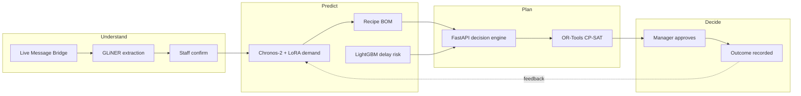

Inside the prototype, state is split by workstream and joined through read-only adapters in `frontend/src/integration/`:

- **P1 Messaging** (`store/demoStore.ts`): messages, extraction reviews, offer qualification, incident verification.
- **P2 Impact** (`services/mock/restaurantStore.ts`): restaurant snapshot, incidents, impact assessment.
- **P3 Plan A** (`integration/planAShared.ts`): external supplier recovery.
- **P4 Plan B** (`integration/planBShared.ts`): internal stock, menu and prep recovery.
- **P5 Governance** (`integration/p5Evidence.ts`, `features/recovery/governance/`): comparison, approval, execution, outcomes, decision memory.

See [docs/development/SHARED_STATE_INTEGRATION.md](docs/development/SHARED_STATE_INTEGRATION.md) for the full event flow.

---

## Worked Example: The Chicken Delivery

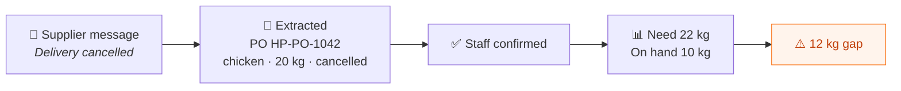

**1 Understand.** The supplier writes that the delivery is cancelled. MouManTAI extracts:

| Field | Value |
|---|---|
| PO | `HP-PO-1042` |
| Ingredient | Chilled chicken |
| Quantity | 20 kg |
| Status | Cancelled → staff **confirmed ✓** |

**2 Predict.** The PO shortfall is 20 kg, but what matters is today's need:

| Menu item | Forecast portions | Chicken / portion | Chicken needed |
|---|---:|---:|---:|
| Chicken Popcorn | 60 | 0.15 kg | 9 kg |
| Chicken Tenders | 40 | 0.20 kg | 8 kg |
| Happy Combo — Chicken Popcorn | 50 | 0.10 kg | 5 kg |
| **Total** | **150** | | **22 kg** |

With **10 kg on hand**, the real gap is **12 kg**, not 20 kg. Flavoured Fries uses no chicken and is unaffected.

**3 Plan** and **4 Decide** are shown below in [Plan A vs Plan B](#plan-a-vs-plan-b) and [Decision Logic](#decision-logic).

---

## Core Features

### 1. Overview (Command Center)
Live KPIs for active incidents, confirmed orders at risk, affected menu items, pending approvals and outcomes awaiting evidence. Operational readiness charts show supply versus need per ingredient up to the 10:45 prep cutoff. The **Supplier disruption demo** button simulates a supplier report, verifies it, assesses impact, recounts stock and resets the scenario.

### 2. Unified Inbox
One inbox for supplier messages from WhatsApp, Outlook email and Telegram, normalised into a single message event.

### 3. Message Intelligence
Extracts PO, ingredient, quantity and status from each message, and links it to an incident. Staff review, correct and confirm in one tap. Supplier offers are qualified before they can be used in a plan.

### 4. Incidents
Verified supply incidents with their linked messages from every channel, correlated to one incident ID.

### 5. Impact Explorer
Recipe-BOM impact per menu item: forecast and confirmed portions, chicken per portion, and which items are affected. Any stock change, such as a recount, marks the impact as stale until it is reassessed.

### 6. Plan A — Supplier Recovery
Compares backup-supplier offers on quantity, price, delivery time and evidence status. Offers that are not verified stay conditional.

### 7. Plan B — Internal Recovery
Recovers without buying: protects confirmed orders first, sets menu limits, reallocates remaining stock, and includes **Menu Recovery** and **Order Protection** panels with a what-if slider.

### 8. Prep Planning
An order-driven prep schedule: batches, portion targets and timing against the prep cutoff.

### 9. Recovery Comparison
Plan A and Plan B side by side on purchase cost, portions served, portions at risk and confirmed-order protection. The manager chooses one.

### 10. Approvals
Versioned approval of the chosen scenario with its full scope (menu-limit tasks, prep batches, purchases) and a required reason. Role-based: Owner, Operations Manager, Procurement Officer, Kitchen Lead, Viewer.

### 11. Execution
A task tracker for the approved plan. Each task moves from approved to simulated execution to awaiting evidence. It's clearly labelled **simulation only**: no supplier, POS or kitchen system is contacted.

### 12. Outcomes
Records what really happened against the plan, with evidence, so outcomes are verified rather than assumed.

### 13. Decision Memory
A history of past disruptions, the option chosen, the reason and the result, which feeds back into future forecasts.

### 14. Channel Connections & Settings
Connection status for each messaging channel and outlet settings.

---

## Plan A vs Plan B

<p align="center">
  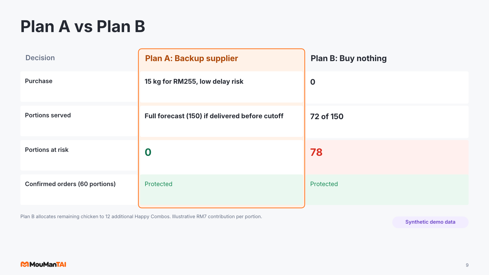
</p>

| Decision | Plan A: Backup supplier | Plan B: Buy nothing |
|---|---|---|
| Purchase | 15 kg for **RM255**, low delay risk | **RM0** |
| Portions served | Full forecast (**150**) if delivered before cutoff | **72 of 150** |
| Portions at risk | **0** | **78** |
| Confirmed orders (60 portions) | Protected | Protected |

Plan B allocates the remaining chicken to 12 additional Happy Combos.

**The trade-off the manager sees:** Plan A spends **RM255** to protect up to **RM546** (78 portions at risk × RM7 illustrative contribution per portion). That's more than twice its cost.

---

## Decision Logic

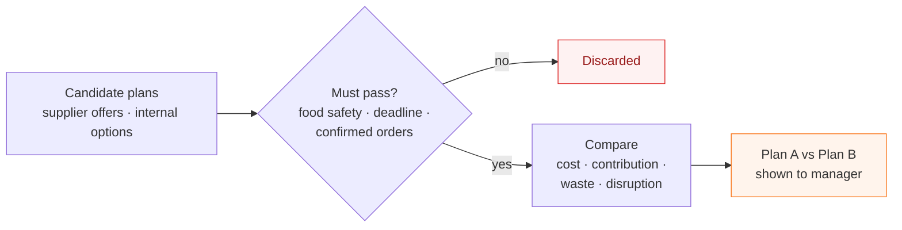

Plans are built **rules first, then optimised**:

| Stage | Criteria |
|---|---|
| **01 Must pass** | Food safety · delivery deadline · protect confirmed orders |
| **02 Then compare** | Cost · contribution · waste · kitchen disruption |

A plan that fails any must-pass rule is never offered, whatever it costs.

The decision is a closed loop: **Approve → Execute → Record outcome → Improve forecasts**, then back to Predict.

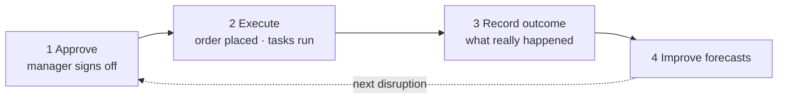

Each execution task follows a strict lifecycle (UML state diagram, from `features/approvals/executionLogic.ts`). Simulation never marks a task verified: only evidence can.

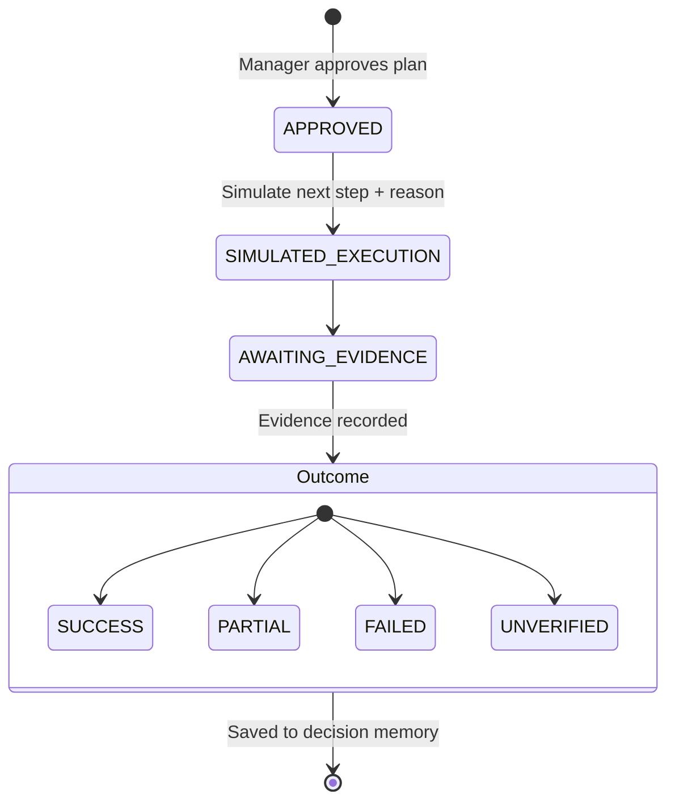

---

## Technical Stack

### Frontend (built)

| Area | Choice |
|---|---|
| Framework | React 19, React Router 7 |
| Build | Vite 8, TypeScript 5.9 |
| State | Zustand 5 plus per-workstream stores and integration adapters |
| Icons | lucide-react |
| Styling | Plain CSS with design tokens (`frontend/src/styles/tokens.css`) |
| Tests | Vitest + Testing Library (jsdom) |
| Hosting | Vercel (static build with an SPA rewrite in `frontend/vercel.json`) |

### Production architecture (designed)

| Area | Choice |
|---|---|
| Message bridge | Node.js: WhatsApp Cloud API (signature-verified webhook), Microsoft Graph (read-only mailbox), Telegram Bot API |
| Extraction | Fine-tuned GLiNER |
| Forecasting | Chronos-2 + LoRA demand, LightGBM supplier delay risk |
| Optimisation | FastAPI decision engine, Google OR-Tools CP-SAT |
| Platform | Runs on FeedMe's existing portal, database and deployment |

No database, AI model, solver, payment or messaging SDK is installed in this repository yet.

---

## Installation

### Prerequisites

- Node.js 20.19+ on the Node 20 line, or Node.js 22.12+ (tested with Node 24)
- npm

### Frontend

```bash
git clone https://github.com/jiahui-1101/MouManTAI_SUC.git
cd MouManTAI_SUC/frontend
npm ci
npm run dev        # http://localhost:5173
```

| Command (in `frontend/`) | Purpose |
|---|---|
| `npm run dev` | Start the development server |
| `npm run typecheck` | TypeScript check |
| `npm test` | Run the test suite once |
| `npm run build` | Typecheck and production build to `dist/` |
| `npm run preview` | Serve the production build |

No backend or external service is needed to run the frontend.

---

## Environment Variables

| Variable | Default | Effect |
|---|---|---|
| `VITE_P5_DEV_MOCKS` | unset | `true` in dev mode runs the P5 governance pages on a self-contained mock world with Dev Controls, which is useful for isolated rehearsal. Leave unset for the integrated end-to-end demo. |

See [docs/P5_Demo_Runbook.md](docs/P5_Demo_Runbook.md) for the rehearsal paths.

---

## Cloud Deployment

The frontend deploys to Vercel as a static site:

| Setting | Value |
|---|---|
| Root directory | `frontend` |
| Framework preset | Vite |
| Build command | `npm run build` |
| Output directory | `dist` |

`frontend/vercel.json` rewrites every path to `index.html`, so deep links such as `/overview` or `/recovery/compare` load correctly on refresh.

---

## Routes

| Path | Page |
|---|---|
| `/` | Redirects to `/overview` |
| `/overview` | Overview |
| `/inbox` | Unified Supplier Inbox |
| `/message-intelligence` | Message Intelligence |
| `/incidents` | Incidents |
| `/impact` | Impact Explorer |
| `/recovery/plan-a` | Plan A — Supplier Recovery |
| `/recovery/plan-b` | Plan B — Internal Recovery |
| `/prep-planning` | Prep Planning |
| `/recovery/compare` | Recovery Comparison |
| `/approvals` | Approvals |
| `/execution` | Execution |
| `/outcomes` | Outcomes |
| `/decision-memory` | Decision Memory |
| `/channels` | Channel Connections |
| `/settings` | Settings |
| anything else | Page not found |

To add a page, add an entry to `frontend/src/constants/navigation.ts` and map its path in `frontend/src/app/router.tsx`. A test fails if the two drift apart.

---

## Project Structure

```text
MouManTAI_SUC/
├── frontend/
│   ├── public/                  static assets
│   ├── src/
│   │   ├── app/                 App root, route table (router.tsx), providers
│   │   ├── layouts/             MainLayout (header + navigation + outlet)
│   │   ├── components/          layout, shared and ui Portal primitives
│   │   ├── pages/               one folder per route (Overview … Settings)
│   │   ├── features/
│   │   │   ├── messaging/       P1 inbox, extraction, review
│   │   │   ├── incidents/       incident correlation
│   │   │   ├── impact/          P2 recipe-BOM impact
│   │   │   ├── recovery/        P3 Plan A, P4 Plan B, P5 governance
│   │   │   ├── approvals/       approval and execution logic
│   │   │   └── outcomes/        outcome verification
│   │   ├── integration/         read-only adapters between workstreams
│   │   ├── services/mock/       synthetic restaurant state and demo actions
│   │   ├── data/fixtures/       Happy Potato dataset (HP-SNAP-001)
│   │   ├── store/               shared demo store
│   │   ├── __dev__/             P5 standalone mock world
│   │   ├── constants/           navigation.ts (single source of nav items)
│   │   ├── styles/              tokens.css, global.css
│   │   └── types/ hooks/ utils/ assets/
│   ├── tests/                   shell, UI, integration and P5 tests
│   └── vercel.json              SPA rewrite
├── backend/                     reserved for the Live Message Bridge (README only)
├── presentation/                HTML pitch deck, logo, QR codes, interview video
└── docs/
    ├── images/                  README figures
    ├── design/                  FeedMe Portal alignment
    ├── development/             workstream and integration notes
    ├── requirements/            shared contracts and P1 requirements
    ├── DESIGN.md
    └── P5_Demo_Runbook.md
```

---

## Business Model

A native add-on, not another platform: it runs on FeedMe's existing portal, database and deployment, so the main new cost is AI message processing and support.

| Plan | Price | Reference |
|---|---:|---|
| Starter | **RM49** / outlet / month | |
| Pro | **RM99** / outlet / month | FeedMe Connect Premium is RM90 / month (FeedMe website) |

Prices still need to be validated with merchants.

### Market

FeedMe serves **~11,000 merchants** across Southeast Asia (FeedMe, Nov 2025 funding announcement). Our first target, **200 outlets**, is less than 2% of that base.

### Projection (200 outlets, 50/50 plan split)

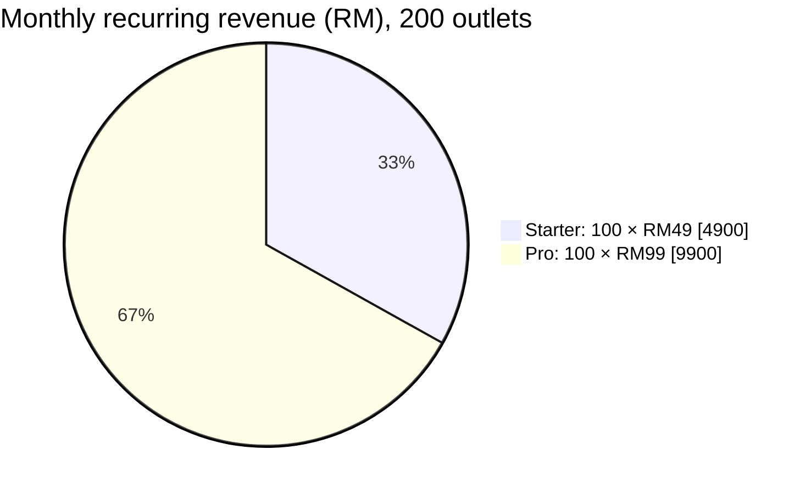

| Line | Monthly |
|---|---:|
| 100 × RM49 Starter | RM4,900 |
| 100 × RM99 Pro | RM9,900 |
| **MRR** | **RM14,800** |
| Operating cost | − RM1,800 |
| **Contribution** | **≈ RM13,000** |

### Merchant ROI (≈ 2 supply disruptions per month)

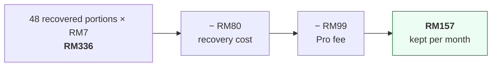

| Line | Monthly |
|---|---:|
| 48 recovered portions × RM7 | RM336 |
| Recovery cost | − RM80 |
| Pro fee | − RM99 |
| **Kept by the merchant** | **RM157** |

Each ringgit of the Pro fee returns more than 2.5× in recovered contribution after recovery costs ((RM336 − RM80) ÷ RM99 ≈ 2.6×). All figures are projections.

---

## Project Materials

| Material | Link | Status |
|---|---|---|
| Live demo | [frontend-blue-pi-70ejij1ipo.vercel.app](https://frontend-blue-pi-70ejij1ipo.vercel.app) | Ready |
| HTML presentation | [`presentation/moumantai-presentation.html`](presentation/moumantai-presentation.html) ([view online](https://htmlpreview.github.io/?https://github.com/jiahui-1101/MouManTAI_SUC/blob/main/presentation/moumantai-presentation.html)) | Ready |
| PDF slides | [`presentation/moumantai-presentation.pdf`](presentation/moumantai-presentation.pdf) | Ready |
| Merchant interview | [`presentation/assets/interview.mp4`](presentation/assets/interview.mp4) | Ready |
| Demo runbook | [`docs/P5_Demo_Runbook.md`](docs/P5_Demo_Runbook.md) | Ready |
| Design guide | [`docs/design/FEEDME_PORTAL_ALIGNMENT.md`](docs/design/FEEDME_PORTAL_ALIGNMENT.md) | Ready |
| Integration notes | [`docs/development/SHARED_STATE_INTEGRATION.md`](docs/development/SHARED_STATE_INTEGRATION.md) | Ready |

---

## Future Improvements

### 1. Live Message Bridge
Build the minimal Node.js bridge in `backend/`: signature-verified WhatsApp Cloud API webhooks, read-only Outlook via Microsoft Graph and Telegram long polling. Provider tokens stay server-side, and the bridge pushes deduplicated events to the web app. It holds no business logic.

### 2. Real Message Understanding
Replace rule-based extraction with fine-tuned **GLiNER**, keeping the staff one-tap confirm as the safety gate.

### 3. Learned Forecasts and Supplier Risk
Replace fixture forecasts with **Chronos-2 + LoRA** demand forecasts per outlet and menu item, and score each backup supplier with a **LightGBM** delay-risk model trained on recorded outcomes.

### 4. Optimised Recovery Plans
Move Plan A / Plan B generation to a **FastAPI** decision engine using **OR-Tools CP-SAT**: hard constraints for food safety, deadlines and confirmed orders, and an objective that balances cost, contribution, waste and kitchen disruption.

### 5. Real Execution and Evidence
Connect approved tasks to FeedMe POS menu limits and supplier ordering, and capture goods-receipt evidence automatically instead of simulating execution.

### 6. Inside the FeedMe Portal
Ship as an add-on using FeedMe's existing sales, stock and order data, then validate pricing through paid pilots.

---

## Team Contributions

Team **NJHL**

> Roles below are inferred from the commit history and branch names. Please review them before submission.

| Team member | Role | Contributions evidenced in the repository |
|---|---|---|
| **Wong Jia Hui** | **Team Lead · Integration & Deployment** | Project foundation, integration across workstreams, Vercel deployment, HTML pitch presentation and documentation. |
| **Bong Zi Shan** | **P1 Messaging & P2 Impact** | Unified inbox, message intelligence, extraction review and incident correlation (P1); restaurant snapshot and impact assessment (P2); shared-state integration and FeedMe Portal UI. |
| **Lee Mei Shuet** | **P3 Plan A — External Recovery** | Backup-supplier recovery, offer qualification and Plan A UI refinements. |
| **Loh Su Ting** | **P4 Plan B — Internal Recovery** | Internal recovery engine, menu recovery, order protection and prep planning. |
| **Gan Rui En** | **P5 Recovery Governance** | Recovery comparison, approvals, execution tracker, outcomes, decision memory and the P5 mobile UI. |

---

## Notes for Judges

MouManTAI is a working end-to-end prototype of the decision loop, not only a UI mockup:

```text
Supplier message
-> extraction + staff confirm
-> verified incident
-> recipe-BOM impact (12 kg real gap, not 20 kg)
-> Plan A vs Plan B under hard rules
-> manager approval
-> simulated execution
-> verified outcome
-> decision memory
```

What is real and what is not:

- MouManTAI is an independent hackathon concept inspired by the FeedMe Portal. It is not affiliated with or endorsed by FeedMe.
- All operational data, channel events and money figures are **synthetic** or **illustrative** (for example, RM7 contribution per portion).
- The prototype uses deterministic calculations. Fine-tuned models, CP-SAT and the live message bridge are the **production architecture**.
- Execution is **simulated**: no supplier, POS or kitchen system is contacted.
- This is not a production food-safety or procurement authorization system.
